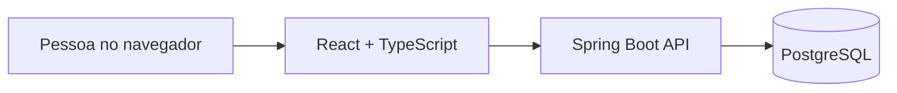
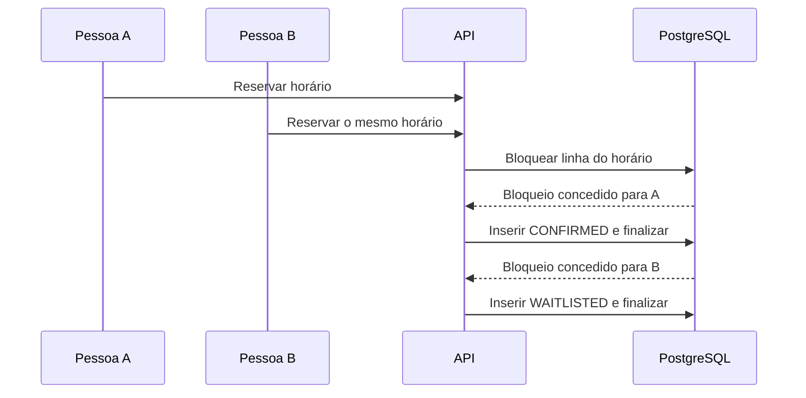

# Arquitetura do Fila Viva

## Fluxo principal

O navegador lista atividades e horários. Ao escolher um horário, envia o nome informado para `POST /api/bookings`. A resposta contém um código UUID, usado para consultar ou cancelar a reserva. O frontend conserva esse código no armazenamento local do navegador; ele não representa uma conta de usuário.

## Por que bloquear o horário no banco?

Duas pessoas podem tentar reservar o último horário ao mesmo tempo. Uma verificação no frontend não garante exclusividade, pois ambas podem ver a vaga livre antes de enviar a solicitação. Na transação de criação, a API usa bloqueio pessimista na linha do horário (`SELECT ... FOR UPDATE`). As solicitações para o mesmo horário passam uma de cada vez: a primeira cria uma reserva `CONFIRMED`; as seguintes criam reservas `WAITLISTED`.

O banco também possui um índice único parcial para impedir mais de uma reserva `CONFIRMED` por horário. Esse índice é uma segunda garantia, independente da lógica da aplicação.

## Cancelamento e promoção

O cancelamento usa o mesmo bloqueio no horário. Se a reserva cancelada estava confirmada, a API busca a primeira reserva em espera por data de criação e UUID, muda seu estado para `CONFIRMED` e conclui tudo na mesma transação. Se a reserva já estava cancelada, a operação não cria outra promoção.

## Dados e limites atuais

- `activities`: tipos de atendimento usados na demonstração.
- `slots`: horários concretos de cada atividade.
- `bookings`: reservas, status e ordem de entrada na fila.
- Flyway cria o esquema; um gerador de dados cria horários futuros para a demonstração.
- Esta versão não tem contas, envio de notificações ou painel de administração. O código da reserva deve ser tratado como acesso privado àquela reserva. Não use dados pessoais reais na demonstração pública.
- A lista de horários faz consultas por horário para calcular disponibilidade e fila; antes de grandes volumes, será substituída por uma consulta agregada e paginação.

## Verificação

`BookingFlowTest` inicia um PostgreSQL isolado com Testcontainers, cria duas reservas concorrentes, verifica que somente uma foi confirmada e que a reserva em espera é promovida após cancelamento. O fluxo também foi exercitado manualmente pela interface web.
